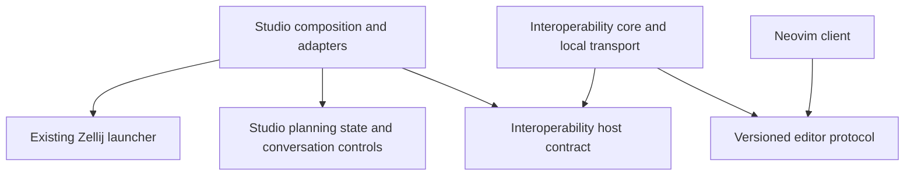

# Authority and dependency boundaries

## Boundary

The independent system supplies the document protocol, its host-facing provider interface, local transport and projection machinery, and the Neovim client. Studio implements the provider and supplies its existing pane launcher. Studio remains authoritative for specification/plan content, schema validation, storage, workflow state, and conversation delivery. The new repository can build and run its complete document-and-feedback loop against a fake host without importing or installing Studio.

A separate repository does not require a separate daemon. For this milestone Studio loads a pinned interoperability package and starts its local endpoint inside the existing process. Neovim connects directly to that endpoint. Projection files remain backed by the host's existing state.

Arrows above are source dependencies. At runtime the core calls the injected Studio provider through the host contract; that call direction does not require an import from the core into Studio. The new package must not import `Attempt`, `LeadDraft`, Socrates schemas, Pi extension types, Studio configuration, or Studio's Zellij implementation. Studio's planning and task-runtime layers must not import the interoperability implementation to admit, execute, or approve work. The Studio composition layer wires domain events and existing application ports to the adapter.

## Ownership

| Owner | Responsibility |
|---|---|
| Independent protocol | Versioned message schemas, opaque identity/revision fields, operation/request IDs, bounded payloads, receipt/status meanings, and editor-facing error categories. |
| Independent core | Authenticated local endpoint, connection generation fencing, request correlation, projection files, serialized refresh/save projection, generic subscriptions, and companion lifecycle coordination through an injected launcher. |
| Independent Neovim client | Ordinary buffers, explicit writes, exact unsaved selection capture, local changed-tick tracking, clean refresh and undo, dirty conflict comparison, compact request outcomes, and revision-safe location navigation. |
| Studio document provider | Translate opaque IDs to the complete Studio owner; render/parse specification and plan Markdown; calculate revisions including workflow guards; validate and commit all writes through existing storage controls. |
| Studio conversation provider behavior | Retain feedback receipts, apply busy/dialog/owner admission rules, deliver to the owning chat through Pi, correlate actual transcript responses and accepted mutations, and report trustworthy outcomes. These methods may live on the same small host-provider adapter. |
| Studio persistence | Authoritative planning records and durable operation/feedback evidence. Existing SQLite storage remains in use. The independent package does not inspect or migrate Studio tables. |
| Studio launch adapter | Configuration and tool availability, canonical checkout selection, Zellij pane/process verification, no-focus launch, manual-close suppression, and explicit reopen. |

The independent system owns how these interfaces are expressed and interpreted. Studio owns the evidence needed to assert that a write committed, a conversation accepted a message, or an answer produced particular revisions. A successful transport response cannot manufacture any of those events.

## Identity and documents

All IDs and revisions below are opaque nonempty strings. The protocol compares them for equality and never parses Studio record IDs, recognizes discovery/attempt variants, computes a specification revision, or treats a pathname as authorization. Studio maps them to its canonical project, conversation, owner kind/ID, document kind, and relevant workflow state. Readable labels and paths are display metadata, not authority.

The authoritative message definitions are [editor_interop.proto](../proto/editorinterop/v1/editor_interop.proto). Generated Protobuf types, not handwritten JSON schemas or Studio aliases, govern both adapters. The principal types are `SessionRef` (provider/project/conversation), `CallContext` (session plus activation generation), `DocumentRef` (session plus owner/document), `DocumentSnapshot`, `SaveCommand`, `FeedbackCommand`, and `FeedbackRecord`. All documents in v1 contain Markdown. Line ranges are 1-based and inclusive.

Studio composition binds each provider activation and connection to a `SessionRef` and a fresh process/session `generation`. `Sync` reports the currently selected owner within that session; switching discoveries changes that active owner even when the conversation ID is unchanged. Existing document buffers and outstanding requests retain their full original `DocumentRef`; a foreground change never rewrites them. A client cannot choose the active owner or manufacture a new binding by editing a projection file. The provider must validate the captured generation and current ownership immediately before the actual state mutation or provider dispatch, including after asynchronous preflight; the transport's earlier comparison is only an additional fence.

`bufferIdentity` identifies the exact editor text when feedback was captured. The range indexes that captured buffer, which can differ from `baseRevision` because it contains unsaved edits. `selectedText` is the actual captured selection and is never replaced with a filesystem reread. This milestone uses whole-line selection; no column/encoding conversion is introduced.

Projection files are disposable views. The core chooses safe local filenames under its configured private directory without interpolating untrusted document IDs into paths, and replaces projections atomically. Wire `DocumentView` pairs the host-owned `DocumentSnapshot` with the core-issued absolute `projectionPath`; the manifest declares the private projection directory. The client verifies containment, rejects symlink escapes and duplicate path mappings, and retains the exact issued document-to-path map; paths never substitute for opaque document identity. Providers cannot supply projection paths. File modification notifications prompt synchronization but do not prove acceptance. Studio's codec continues to preserve all supported fields and reject invalid/protected changes; the independent core handles Markdown as text.

## Host provider contract

The independent package defines [host.ts](../src/host.ts), importing generated Protobuf values. Studio implements it, and the standalone fixture implements it without Studio. Pi contexts, application records, database handles, and callbacks that mutate `Attempt` objects cannot cross this interface.

`HostProvider` exposes `openSnapshot(call)`, `save(call, command)`, `submitFeedback(call, command)`, and `onChanged(listener)`. `CallContext` is constructed from the authenticated connection and the generation supplied at activation, never from editable text. Studio revalidates the captured context against its live activation and current owner immediately before effects, including after asynchronous preflight.

`openSnapshot` returns a `SnapshotReader` with a header, `next()` yielding one typed document or feedback item at a time, and `close()`. The reader must represent one consistent logical read view: stable membership and immutable item values, no duplicate document/request IDs, only the authorized session, and documents belonging to the header's active owner. The core closes it on completion, cancellation, expiry, or error. The Studio adapter may use its existing transactional storage and a private snapshot spool; the new core never inspects tables. This interface permits incremental retrieval without requiring an unbounded `WorkspaceSnapshot[]` aggregate.

Missing drafts are absent, not invented empty documents. Older owner-bound receipts may remain inspectable, but only currently bound documents are writable or eligible for delivery. A document absent from a complete, validated snapshot detaches its editor buffer; local text remains recoverable. Partial pages, an expired snapshot, and a failed read never establish absence.

### Save atomicity and reconciliation

`save` checks the complete binding, workflow protection, expected revision, and candidate validation through Studio's existing policy. Approval, freeze, dispatch, and reopening are absent from the interoperability contract. Studio's own agent tools retain candidate-bound revision checks; extraction cannot protect only the editor.

For every accepted save, Studio must commit the document mutation and either its complete accepted receipt or an operation-specific commit witness in the **same authoritative transaction**. The witness binds the operation ID to the exact normalized `SaveCommand`, document identity, accepted revision and immutable accepted snapshot. A witness cannot be a timestamp, a current-text comparison, or an unbound success marker. `AcceptedSave.commitWitnessId` refers to that retained evidence. The generic journal may project a receipt after commit, but it is not allowed to be the sole success evidence across a separate transaction.

Before any repeat effect, the provider looks up that operation's authoritative witness. The exact same command returns its original accepted result even if another writer has since advanced the document. It never overwrites newer state or makes an old snapshot the current projection. The same ID with a different command is rejected as `OPERATION_ID_REUSED`. A rollback before commit leaves neither mutation nor witness. A crash after commit but before the reply leaves both, so the next explicit repeat can recover the accepted result.

**Text equality alone never proves that this operation committed.** An unrelated operation may have written identical text, and content-derived revision tokens can recur. Old incomplete journal entries without an authoritative operation witness remain `uncertain`, including when the current text matches their candidate. They are not automatically replayed or upgraded to accepted. The adapter must fail clearly rather than claim atomic acceptance if its storage boundary cannot persist the witness with the document mutation.

Neovim keeps the exact submitted text and changed-tick alongside a pending save. An accepted result clears modified state only if the buffer still matches that candidate; later edits remain modified against the accepted base. A late receipt cannot roll back a newer projection or clean buffer. Explicit `:write` may reconcile the same pending operation. A lost response means uncertainty until the operation's witness is read, not inferred failure or success.

Required crash/race cases are recorded in [atomicity-scenarios.json](../tests/fixtures/atomicity-scenarios.json): rollback before commit, lost reply after commit, intervening writer, identical text written by another operation, payload reuse, and historical incomplete evidence.

## Feedback and response evidence

`FeedbackRecord` retains the exact `FeedbackCommand`, originating generation, typed state, reason, concise summary, actual response ID, and typed committed document changes. The fixed v1 states are `queued`, `dispatching`, `awaiting`, `parked`, `answered`, `failed`, and `uncertain`; their wire enum names are defined in the Protobuf schema.

`submitFeedback` durably records an exact request before returning a receipt. Duplicate request IDs must either return the same request's existing receipt or reject different content; a duplicate is never another chat dispatch. Cancellation before submission sends nothing. Receipt acceptance means `queued`, not `answered`.

The Studio adapter owns transitions that depend on its conversation lifecycle. Busy sessions and blocking dialogs hold requests in `queued`; an owner change before delivery parks the request. Returning to the same owner in the same generation may resume an undelivered parked request. On a generation change, unfinished `queued`, `dispatching`, `awaiting`, and `parked` records become `uncertain`, preserving their original generation and evidence. Already `answered` and conclusively `failed` records remain terminal and unchanged; already `uncertain` records remain uncertain. Reconnection never converts a completed outcome back to pending or resubmits it. `failed` means a confirmed failure, while ambiguous delivery/outcome uses `uncertain`. The complete transition table is in [generation-scenarios.json](../tests/fixtures/generation-scenarios.json). Preflight cancellation and failed/ambiguous delivery retain distinct evidence; time elapsed or the next unrelated assistant message cannot establish delivery or an answer.

`awaiting` requires observed admission of that request to its original conversation. `answered` requires a real correlated transcript response and a concise outcome. `changes` contains only document revisions actually committed during that attributed response; an explanation-only answer has `changes: []`. The adapter preserves the current admission ordering: assessment invalidation occurs before it captures the revision supplied to the model. Internal commands and cancelled/parked input do not acquire operator-admission effects.

The protocol does not carry the full chat transcript. Neovim displays a compact outcome and may show the original excerpt; the full response stays in Studio. A changed location is navigable only against the corresponding `afterRevision`. If that revision is no longer the displayed clean text, retain the outcome with an explicit stale/conflict indication instead of jumping to an unrelated line. `answered` and `applied in this buffer` remain independent facts.
